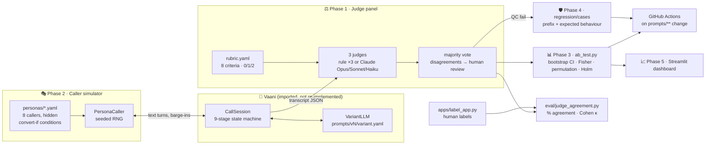

<div align="center">

# 📞 CallQC

### Call quality scoring & prompt A/B testing for voice AI sales agents in Indian BFSI

**Score every call. Test every prompt change on simulated callers first. Block bad prompts in CI.**

[](https://github.com/krishagarwal314/callqc/actions/workflows/prompts-ci.yml)


[Results](RESULTS.md) · [Playbook](PLAYBOOK.md) · [Rubric](rubric.yaml) · [Vaani agent](https://github.com/krishagarwal314/vaani) · 🎬 Demo video: _coming soon_

</div>

---

## ✨ Highlights

<table>
<tr>
<td width="50%">

**⚖️ 3-judge panel on an 8-point BFSI rubric**
Majority vote, disagreements flagged for human review, and every score backed by a quoted turn.

**🚫 Mechanical hallucination check**
Every rate and rupee amount must trace back to a tool call or to the caller's own words. An invented "9.99 percent" is an automatic fail.

**🎭 8 simulated callers with hidden goals**
Being polite doesn't convert anyone. A caller only converts if the agent actually says what they need to hear.

</td>
<td width="50%">

**📊 A/B tests that don't overclaim**
Bootstrap CIs, Fisher and permutation tests, and Holm correction. A lift is only called significant if it passes the corrected test.

**🛡️ CI that blocks bad prompts**
Failed calls become regression tests. Any change to `prompts/**` runs the suite and an A/B smoke test.

**📈 Dashboard + labelling tool**
Shows the worst calls with the breaking turn highlighted, and compares variants side by side.

</td>
</tr>
</table>

## 🏆 Results

<div align="center">

| | Baseline | Best variant | |
|:--|:--:|:--:|:--|
| **Conversion** | 20.0% | **43.3%** | **+23.3 pp** (95% CI +15.0 to +31.3, Holm p < 0.00001) |
| **Rubric score** | 11.77 / 16 | **14.40 / 16** | +2.63 |
| **QC fail rate** | 5.0% | **0.8%** | |

**1,440** simulated calls · **5** prompt variants + 1 sanity check · **8** personas · **9** regression tests

</div>

Every number comes from a re-runnable script: `make results` → [RESULTS.md](RESULTS.md).

## ✅ Project phases: all complete

| # | Phase | What it delivers | Status |
|:-:|---|---|:-:|
| 1 | **LLM-as-judge** | [rubric.yaml](rubric.yaml) with 8 criteria × 3 levels × 2 worked examples · 3-judge panel with majority vote · structured JSON output · hand-labelling app · [judge_agreement.py](eval/judge_agreement.py) (agreement %, Cohen's κ, confusion matrix, rubric v1.0 vs v1.1) | ✅ |
| 2 | **Caller simulator** | 8 [personas](personas/) with hidden convert-if conditions · drives Vaani's real `CallSession` · seeded and reproducible · turn limit · bad-prompt sanity check | ✅ |
| 3 | **A/B testing** | [ab_test.py](ab_test.py): conversion, per-criterion scores, QC fail rate and call length, with bootstrap CIs and Holm-corrected tests · 5 variants, each with a written hypothesis | ✅ |
| 4 | **Regression + CI** | Save any failed call as a test (prefix + expected behaviour) · 7 behaviour checks · [GitHub Actions](.github/workflows/prompts-ci.yml) gate on `prompts/**` | ✅ |
| 5 | **Dashboard + playbook** | [Streamlit dashboard](apps/dashboard.py) with 4 views · [PLAYBOOK.md](PLAYBOOK.md): every pattern backed by an A/B result | ✅ |

## 🏗️ Architecture



## 🚀 Quickstart

```bash
git clone https://github.com/krishagarwal314/vaani
git clone https://github.com/krishagarwal314/callqc && cd callqc
pip install -e ../vaani -e ".[dev,ui]"

make test         # 20 tests
make ab           # 6 variants × 8 personas × 30 calls
make agreement    # judge agreement, rubric v1.0 vs v1.1
make gate         # regression suite + A/B smoke + harness self-test (what CI runs)
make results      # everything above → RESULTS.md
make dashboard    # 📈 Streamlit dashboard
make label        # ✍️ hand-labelling tool
```

Compare any set of variants (the first one is the control):

```bash
python ab_test.py --variants prompts/v1_baseline prompts/v2_ack_objection --calls-per-persona 25 [--judges claude]
```

## 🔍 How each phase works

<details>
<summary><b>Phase 1 · LLM-as-judge with an 8-point BFSI rubric</b></summary>

- **Criteria:** script adherence · mandatory disclosures · objection handling · hallucinated figures · tone & empathy · escalation / graceful exit · compliance · outcome. Each is scored 0/1/2 with a quoted justification.
- **Critical criteria:** a 0 on disclosures, hallucinated figures, escalation or compliance fails QC.
- **Panel:** three judges and a majority vote; any disagreement goes to `needs_human_review`. Offline, the panel is three rule-based judges with different prompt styles (strict, lenient, literal). With `--judges claude` it is Claude Opus 5.5, Sonnet 5.5 and Haiku 5.5 with JSON-schema structured output.
- **Human labels:** a blind Streamlit labelling page, plus `eval/judge_agreement.py` for agreement %, Cohen's κ per criterion and overall, single judge vs panel, and a confusion matrix, for each rubric version.
</details>

<details>
<summary><b>Phase 2 · Caller simulator</b></summary>

- **Personas:** price-sensitive · distrustful · confused about terms · busy/impatient · interrupter · Hinglish code-mixer · already has a loan · polite but uninterested.
- **Hidden goals:** each persona converts only if specific signals appear in the agent's words. The polite-uninterested persona converted 0% under every variant.
- **Real agent:** the simulator drives Vaani's real engine, including barge-ins, amount read-backs and do-not-call guardrails.
- **Paired runs:** seeds are shared across variants (common random numbers), so comparisons are paired and reproducible.
</details>

<details>
<summary><b>Phase 3 · A/B testing</b></summary>

- **Per variant:** conversion · applied-or-callback rate · rubric score per criterion · QC fail rate · call length, each with 95% bootstrap CIs.
- **Significance:** Fisher exact test on conversion and a permutation test on the rubric total, Holm-corrected across variants. There is also a per-persona breakdown for persona-specific hypotheses.
- **Hypotheses:** every variant states its hypothesis in `prompts/<variant>/variant.yaml`.
</details>

<details>
<summary><b>Phase 4 · Regression suite + CI</b></summary>

- **Save a failed call:** `python -m callqc.regression save <call.json> --criterion hallucinated_figures --expect must_not_invent_figures`
- **Checks:** `must_not_invent_figures` · `must_readback_amount` · `must_disclose_identity` · `must_disclose_indicative` · `must_honour_dnc` · `must_not_pressure` · `must_acknowledge_objection`
- **The CI build fails if:**
  - a regression case fails,
  - the mean rubric total drops more than 0.5 below [results/baseline.json](results/baseline.json), or
  - the deliberately bad prompt stops scoring clearly worse (the harness self-test).
</details>

<details>
<summary><b>Phase 5 · Dashboard + playbook</b></summary>

- **Dashboard tabs:** scores over prompt versions · per-criterion and per-persona breakdown · worst calls with the breaking turn highlighted in red · side-by-side A/B with lift CIs.
- **[PLAYBOOK.md](PLAYBOOK.md):** what helped (explicit objection acknowledgement, the indicative-rate disclosure), what was neutral (a shorter consent line), and what hurt (pressure tactics), each with its A/B numbers.
</details>

## 💡 Key findings

| Pattern | Effect on conversion | Verdict |
|---|---|:-:|
| Acknowledge the objection explicitly ("that's a completely fair concern") | **+10.4 pp** (Holm p = 0.023) | 🟢 helped |
| State that rates are indicative, subject to approval | **+12.9 pp** (Holm p = 0.006) | 🟢 helped |
| All of the above + concise consent (now production) | **+23.3 pp** (Holm p < 0.00001) | 🟢 helped |
| Shorter consent line on its own | +0.0 pp (n.s.), but +57 pp callbacks for busy callers | 🟡 neutral |
| Urgency + invented figures + no disclosures | **−16.7 pp**, 100% QC fail | 🔴 hurt |

🐞 **Bug found in Vaani:** if a caller barges in during the consent line, the recording notice is never repeated. It is tracked as a known-issue regression case.

## 📁 Repo layout

```
callqc/            vaani_adapter · personas · simulator · judges · stats · regression · labels
ab_test.py         A/B testing entry point
eval/              judge_agreement.py · ci_gate.py · make_results.py
apps/              label_app.py · dashboard.py
prompts/           one folder per variant + production.yaml
personas/          8 caller personas
regression/cases/  saved regression tests
rubric.yaml        rubric v1.1 (rubric_v0.yaml = pre-revision draft)
results/           ab/latest.json · judge_agreement.json · baseline.json
tests/             20 tests
```

## 🧭 Design notes

- **Offline by default, LLM when you want it.** The reproducible numbers use rule-based judges and Vaani's MockLLM, so CI is free and deterministic. With an API key, the same pipeline runs with Claude judges, an LLM-played caller and Vaani's real LLM backend.
- **Simulated callers have limits.** Persona conditions encode the hypotheses being tested, so the lifts show the harness detects real effects. Confirm the size of any lift on a live holdout before relying on it.

<div align="center">

Built on top of **[Vaani](https://github.com/krishagarwal314/vaani)** · the outbound voice AI loan agent for English, Hindi & Hinglish

</div>
