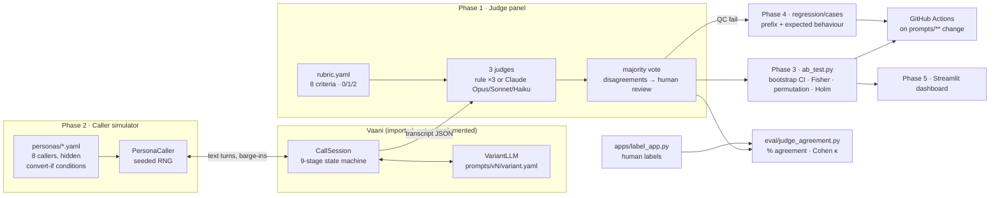

# CallQC

**Call quality scoring and prompt A/B testing for voice AI sales agents in Indian BFSI.**

CallQC scores transcripts from the [Vaani](https://github.com/krishagarwal314/vaani) outbound loan agent on an 8-point BFSI rubric with a
3-judge panel. It tests prompt changes against 8 simulated caller personas before they go live, and blocks bad
prompt changes in CI.

**Status: complete.** All five phases are built and tested: judge panel, caller simulator, A/B testing,
regression suite with CI, and the dashboard with a playbook. Every number in [RESULTS.md](RESULTS.md)
is produced by a re-runnable script (`make results`).

Demo video: _link to be added_

## Results at a glance

| | |
|---|---|
| Prompt variants tested | 5 + 1 sanity-check bad prompt |
| Simulated calls | 1,440 |
| Conversion, baseline → best | 20.0% → 43.3% (+23.3 pp, 95% CI +15.0 to +31.3, Holm p < 0.00001) |
| Rubric score, baseline → best | 11.77 → 14.40 / 16 |
| Regression tests | 9 (8 passing on production, 1 tracked known issue) |

Full tables: [RESULTS.md](RESULTS.md). What worked and why: [PLAYBOOK.md](PLAYBOOK.md).

## Architecture



## Quickstart

```bash
# Vaani must sit next to this repo (or set VAANI_PATH)
pip install -e ../vaani -e ".[dev,ui]"

make test                 # 20 tests
make ab                   # 6 variants × 8 personas × 30 calls → results/ab/latest.json
make agreement            # judge agreement, rubric v1.0 vs v1.1
make gate                 # regression suite + A/B smoke + harness self-test (what CI runs)
make results              # all of the above → RESULTS.md
make dashboard            # streamlit dashboard
make label                # hand-labelling tool
```

`ab_test.py` takes any set of variants. The first one is the control:

```bash
python ab_test.py --variants prompts/v1_baseline prompts/v2_ack_objection --calls-per-persona 25 [--judges claude]
```

## How it works

### Phase 1 · LLM-as-judge with an 8-point BFSI rubric
- [rubric.yaml](rubric.yaml) defines the 8 criteria (script adherence, mandatory disclosures, objection handling,
  hallucinated figures, tone, escalation/exit, compliance, outcome), each scored 0/1/2 with a definition and two
  worked examples per level. Four criteria are critical: a 0 on any of them fails QC.
- **Hallucinated figures are checked mechanically:** every rate and rupee amount the agent says must match a
  tool-call result or the caller's own words (Vaani's Indian-numbering parser handles "five lakh rupees").
- **Panel:** three judges with majority vote. Any criterion where they disagree is flagged in
  `needs_human_review`. Offline, the three are rule-based judges with different prompt styles
  (strict/lenient/literal). `--judges claude` swaps in Claude Opus 5.5, Sonnet 5.5 and Haiku 5.5, using
  structured JSON output (`output_config.format` with a JSON schema).
- [apps/label_app.py](apps/label_app.py) is a blind hand-labelling page. [eval/judge_agreement.py](eval/judge_agreement.py)
  reports % agreement, Cohen's κ per criterion and overall, single judge vs panel, and a confusion matrix, for
  each rubric version ([rubric_v0.yaml](rubric_v0.yaml) → [rubric.yaml](rubric.yaml)).

### Phase 2 · Caller simulator
- 8 personas in [personas/](personas/): price-sensitive, distrustful, confused about terms, busy/impatient,
  interrupter, Hinglish code-mixer, already has a loan, polite but uninterested.
- Each persona has hidden `convert_if` signals that the agent's actual words must contain. Being polite
  doesn't convert anyone: the polite-uninterested persona converted 0% under every variant in the 1,440-call run.
- The simulator drives Vaani's real `CallSession`, including barge-ins and amount read-backs. It has a turn limit
  and seeded randomness, and seeds are shared across variants (common random numbers), so A/B comparisons are paired.

### Phase 3 · A/B testing
Each variant gets conversion rate, applied-or-callback rate, per-criterion rubric means, QC fail rate and call
length, all with 95% bootstrap CIs. Treatments are compared with the control using a Fisher exact test
(conversion) and a permutation test (rubric total), Holm-corrected. Every variant states its hypothesis in
`prompts/<variant>/variant.yaml`.

### Phase 4 · Regression suite + CI
- `python -m callqc.regression save <call.json> --criterion hallucinated_figures --expect must_not_invent_figures`
  turns a failed call into a test case: the caller lines before the breaking turn, plus expected behaviours.
- Seven checks: `must_not_invent_figures`, `must_readback_amount`, `must_disclose_identity`,
  `must_disclose_indicative`, `must_honour_dnc`, `must_not_pressure`, `must_acknowledge_objection`.
- [.github/workflows/prompts-ci.yml](.github/workflows/prompts-ci.yml) runs on changes to `prompts/**`. It runs
  pytest, then [eval/ci_gate.py](eval/ci_gate.py) on the changed variants. The build fails if a regression case
  fails, if the mean rubric total drops more than 0.5 below [results/baseline.json](results/baseline.json), or if
  the deliberately bad prompt stops scoring clearly worse (the harness self-test).

### Phase 5 · Dashboard + playbook
[apps/dashboard.py](apps/dashboard.py) has four tabs: scores across prompt versions, a per-criterion and
per-persona breakdown, the worst calls with the breaking turn highlighted, and side-by-side A/B comparison
with the lift CI. [PLAYBOOK.md](PLAYBOOK.md) lists each pattern with the A/B result behind it.

## Repo layout

```
callqc/            vaani_adapter, personas, simulator, judges (+panel), stats, regression, labels
ab_test.py         Phase 3 entry point
eval/              judge_agreement.py, ci_gate.py, make_results.py
apps/              label_app.py, dashboard.py (Streamlit)
prompts/           one folder per variant + production.yaml
personas/          8 caller personas
regression/cases/  saved regression tests
rubric.yaml        current rubric (v1.1); rubric_v0.yaml is the pre-revision draft
results/           ab/latest.json, judge_agreement.json, baseline.json
tests/
```

## Design notes
- **Offline by default, LLM when you want it.** The reproducible numbers use rule-based judges and Vaani's
  MockLLM with each variant's policy switches, so CI is free and deterministic. With an API key, the same
  pipeline runs with Claude judges (`--judges claude`), an LLM persona (`ClaudeCaller`) and Vaani's real LLM
  backend (the variant's `system_addendum` is appended to Vaani's system prompt).
- **Simulated callers have limits.** Persona conditions encode the hypotheses being tested, so lifts show the
  harness can detect an effect, not its real-world size. Confirm on a live holdout before you rely on a number.
